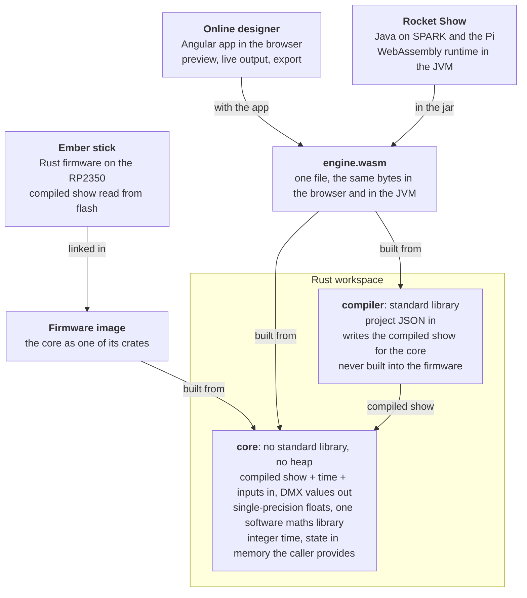

# Lighting engine – concept

One lighting engine for Rocket Show, the online designer and Ember: written once in Rust, built as a crate inside the
Ember firmware and as one WebAssembly file that both the designer and Rocket Show load.

Status: concept, 11 November 2026. The core, the compiler and `engine.wasm` of phases 1 and 2 exist in this repository
and pass the conformance cases (see `README.md`); the spike of phase 0 on the hardware and the three clients are still
to do. Figures marked _estimate_, _proposed_ or _to measure_ are not measured; the measured frame times come from the
Java engine. The code of the three clients was read on 11 November 2026 (`rocketshow` and `show-designer` on `develop`,
`ember` with its concept of 7 November).

## 1. Decisions

| Topic                   | Decision                                                                                                                                                                                                     |
| ----------------------- | ------------------------------------------------------------------------------------------------------------------------------------------------------------------------------------------------------------ |
| Language of the engine  | **Rust**, as a core without the standard library and without a heap (section 3)                                                                                                                              |
| Builds                  | **Two binaries for three clients:** the core as a crate of the Ember firmware, and one `engine.wasm` for the designer and Rocket Show (section 4)                                                            |
| Rocket Show             | **Runs the WebAssembly in the JVM**, with whichever Java WebAssembly runtime works (Endive or Chicory first). A native library through JNA is the fallback if it is too slow on SPARK's hardware (section 9) |
| Ember                   | **The engine runs on the stick.** No frame player and no baked frames at first, and no audio support (section 7)                                                                                             |
| Ember's firmware        | **Rust on embassy if the spike proves it, otherwise C on the pico-sdk** (section 7)                                                                                                                          |
| Numbers                 | **Single-precision floats everywhere**, with one software maths library on all three targets (section 5)                                                                                                     |
| Time                    | **A 64-bit integer of microseconds, passed in** (section 5)                                                                                                                                                  |
| Show file for the stick | **A versioned compiled format with feature bits** (section 6)                                                                                                                                                |
| Designer                | **A recompile has to feel instant** (section 8)                                                                                                                                                              |
| Old projects            | **Not relevant yet:** the compiler reads the current project version only                                                                                                                                    |
| Repository              | **`Rocket-Show/lighting-engine`**, which publishes the `.wasm` file per version                                                                                                                              |

Two numbers can still change the plan, and a spike of a few days measures both: the frame time on the RP2350, and the
frame time of the WebAssembly inside the JVM on SPARK's hardware (section 11).

**This reverses a decision of the Ember concept.** Its version of 7 November says "no engine on the device": the browser
renders frames and the stick plays them back. With the engine on the stick, sections 2 and 5 of that concept change.

## 2. Starting point

Two engines exist today and are kept equal by hand; Ember would be the third.

|                     | Rocket Show                                                                                    | Online designer                                                                                     | Ember                                |
| ------------------- | ---------------------------------------------------------------------------------------------- | --------------------------------------------------------------------------------------------------- | ------------------------------------ |
| Language            | Java 21                                                                                        | TypeScript (Angular)                                                                                | Firmware for the RP2350, not started |
| Where the engine is | `lighting/designer` in rocketshow, about 14,500 lines; `DefaultDesignerService` alone is 4,400 | About 80 model files plus the preview, preset, fixture and timeline services of `projects/designer` |                                      |
| Numbers             | `double` throughout (about 1,000 declarations)                                                 | JavaScript numbers, which are doubles                                                               | Single precision in hardware         |
| Time                | Milliseconds as a `double`                                                                     | `performance.now()`, a double                                                                       | No clock of its own                  |
| Reads               | Project JSON, migrated on load                                                                 | Project JSON, migrated on load                                                                      | A file copied onto it                |

Three things already in the code make a shared core easier than a fresh port.

- **The conformance cases.** 32 files of cases in `web/projects/designer/conformance` of the designer are recorded from
  the designer and compared exactly by `DesignerConformanceTest` in Rocket Show. CI checks that both repositories hold
  the same copy. They become the acceptance test of the new core.
- **The discipline for equal numbers.** `ArcTangent`, `CycleSine` and `PixelMath` exist in both languages, written from
  the fdlibm polynomials, because `Math.atan2` and `Math.sin` round differently in Java and in the browser.
  Random-looking effects come from a hash of whole numbers. The engine needs little maths beyond floor, min, max, abs
  and square root: a sine, an arc tangent and three calls of `pow`.
- **The measured frame times.** After the chase fix, the Java engine takes 0.5 ms a frame for 30 fixtures and 600
  channels, and 1.1 ms for 60 fixtures and 1,200 channels, on one core of a 2.3 GHz Xeon. A frame has 25 ms at 40 Hz.
  The shelved floor-unit concept (`old-concept.md` of Ember, section 4) drew the rule from this that everything fixed is
  worked out on load; the compiled format is that rule made into a file.

**What changes for Ember.** With the engine on the stick, a scene follows tap and MIDI clock live instead of being a
stretched loop, patterns that never repeat have no seam at 32 beats, the render pass of a minute or two goes away, and a
show is kilobytes instead of megabytes. The price is the one the Ember concept wanted to avoid: the stick's firmware has
to keep up with the designer. The versioned format is the answer to that.

## 3. Rust or C

Rust for the core, because the same source has to give the same bits on three targets, and Rust's defaults already do
what C needs flags for. The chip needs native code, not C as such.

| Question                                            | Rust                                                                                                                                                                       | C                                                                                                                                                                                                                                                       |
| --------------------------------------------------- | -------------------------------------------------------------------------------------------------------------------------------------------------------------------------- | ------------------------------------------------------------------------------------------------------------------------------------------------------------------------------------------------------------------------------------------------------- |
| A core without the standard library                 | `#![no_std]` is a mode of the language: a call into the standard library does not compile                                                                                  | A convention, kept by review and by what is linked                                                                                                                                                                                                      |
| The same maths library everywhere                   | Without the standard library there is no `sin` or `pow` at all, so the `libm` crate (written in Rust) is the only source on every target                                   | Each toolchain brings its own libm (newlib on the chip, another for WebAssembly); a vendored one needs `-fno-builtin` on every build                                                                                                                    |
| Fused multiply-add                                  | Never formed from `a * b + c`; only an explicit `mul_add` fuses ([f32 docs](https://doc.rust-lang.org/std/primitive.f32.html))                                             | GCC fuses by default outside the strict ISO modes ([GCC options](https://gcc.gnu.org/onlinedocs/gcc/Optimize-Options.html)). The Cortex-M33 has the instruction and WebAssembly has not, so the bits differ unless every build sets `-ffp-contract=off` |
| Float to DMX value                                  | The `as` cast rounds towards zero, saturates, and turns NaN into 0, on every target ([Rust reference](https://doc.rust-lang.org/reference/expressions/operator-expr.html)) | Out of range is undefined behaviour, and differs between targets in practice                                                                                                                                                                            |
| A damaged or hostile show file on the stick's drive | Slices are bounds-checked: a bad offset is an error                                                                                                                        | A bad offset is memory corruption unless every read is checked by hand                                                                                                                                                                                  |
| WebAssembly                                         | `wasm32-unknown-unknown` is a standard target and needs no libc                                                                                                            | Works, through clang or Emscripten, with a libc to choose                                                                                                                                                                                               |
| RP2350                                              | `thumbv8m.main-none-eabihf` for the Cortex-M33 cores; rp235x-hal and embassy-rp support the chip                                                                           | The pico-sdk is the chip's home, and the board notes in Ember's `FIRMWARE.md` are written against it                                                                                                                                                    |

What Rust costs:

- **A second toolchain.** The designer's and Rocket Show's builds should not need Rust. This repository's CI publishes
  the `.wasm` file for each version, for npm and Maven. The firmware takes the core as a crate.
- **A language to learn** for whoever maintains the engine. The core is arithmetic over tables with no threads and no
  heap, which is the easy part of Rust.
- **Panics.** The core builds with `panic = "abort"`, and the lints forbid unchecked indexing and `unwrap` in the frame
  path, so nothing can panic while a show plays.

**The firmware around the core can be Rust as well** (section 7). C on the pico-sdk is the fallback; the core then goes
in as `libengine.a` with a generated C header.

## 4. Architecture

One Rust workspace holds a core that only computes and a compiler that only translates, and every client reaches them
through the same few calls.

Ember links the core alone. The designer and Rocket Show load one WebAssembly file that also holds the compiler, so only
they ever read JSON.

| Call                       | What it does                                                                                                                                                                                                            |
| -------------------------- | ----------------------------------------------------------------------------------------------------------------------------------------------------------------------------------------------------------------------- |
| `check(show)`              | Validates a compiled show: version, features, every offset and index, the checksum. Returns the working memory it needs, or the reason it can't be played                                                               |
| `init(show, state)`        | Builds the working state in memory the caller hands over                                                                                                                                                                |
| `set_…(state, time, …)`    | Inputs, each with its time: setlist entry or scenes, composition position and holds, tempo, tap and beat one, master dimmer, blackout, identify. Rocket Show and the designer also pass audio frames; Ember passes none |
| `render(state, time, out)` | Writes the values for that moment, per fixture and as DMX universes after the patch. No allocation, no input or output                                                                                                  |
| `compile(json, features)`  | Compiler only: project JSON in, compiled show out, or the list of what the target can't play                                                                                                                            |

Rules of the boundary:

- **Only integers, single floats and byte ranges cross it.** No strings, no callbacks, no imports. That is what lets the
  same `.wasm` file run in a browser and in a JVM, and it rules out wasm-bindgen, whose output needs JavaScript glue.
- **Indices, not UUIDs.** The core knows scene 7, not a UUID. The compiler returns the table from UUID to index for
  hosts that address by UUID, like `setSelectedSceneUuids` in Rocket Show.
- **The state is a value, not a global.** The designer runs several at once: the preview, the simulator of the stick, an
  export.
- **One call at a time per state.** Locks stay in the host, as `synchronized` does in Java today.
- **Two outputs.** The 3D preview draws from the values per fixture (`getChannelValues` today) and the stick patches per
  fixture, so `render` gives those as well as the finished universes.

Everything else stays in the hosts: clocks, threads, files, USB, PIO, OLA, MIDI and the measuring of audio. The beat
clock moves into the core, because tap and beat one must behave the same on the stick as on SPARK.

## 5. Rules of the core

### No standard library, and no heap either

- No files, threads or clock. JSON lives in the compiler crate.
- No heap in the core. The compiled show states how much working memory it needs, and the caller provides it. The stick
  can then refuse a show that is too big before it plays, and the designer can say so before copying.
- No allocation and no unbounded loop in `render`: the work of a frame is fixed by the counts in the show's header.

### Single precision, one maths library, and nothing that changes the bits

- Addition, subtraction, multiplication, division and square root are rounded the same way on the chip, in WebAssembly
  and in the JVM. They need no care beyond using `f32` everywhere.
- The sine comes from the `libm` crate on all three targets, the chip included, after the cycle is reduced to a quarter
  the way `CycleSine` does it. The core needs no arc tangent and no `pow`: where a spot points each moving head is
  worked out by the compiler, in double precision, and stored in the show.
- No fused multiply-add, no NaN reaching an output, and float to integer only through the saturating `as` cast.
- Numbers from the project are rounded to `f32` once, in the compiler. JavaScript never does engine arithmetic on them.

### Time as a 64-bit integer, reduced before it becomes a float

- The host passes microseconds as a `u64`. A 32-bit count of milliseconds would wrap after 49.7 days, which a museum
  loop can reach. Inside, the core counts nanoseconds in an `i64` (292 years), so a period following the tempo is whole
  to a billionth of a second.
- A float of seconds resolves a millisecond only up to 2.3 hours (2^13 s), and a float of milliseconds counts whole
  milliseconds only up to 4.7 hours (2^24 ms).
- Each effect takes its phase as `(time − start) mod period` in integers and only then converts to a float between 0
  and 1. The precision of a frame never depends on how long the show has run.
- The beat clock keeps its position as a 64-bit fixed-point number of beats and re-anchors on every change, where
  `BeatClock` uses doubles today.
- The core has no frame rate. The stick calls `render` every 25 ms, the preview on every animation frame, and equal
  times give equal values.

### Decisions are made on integers

A tolerance of ±1 covers values, not decisions. Where a comparison picks a step of a chase, a slot of a colour wheel or
the input of a pixel hash, a float that lands on the other side of the line gives a different colour, not a value one
off. Times, step indices and hash inputs therefore stay integers, and a float is never floored into a decision without a
defined rule. This matters most in `PixelPatterns` and `PresetSteps`.

## 6. The compiled show format

The compiled show is the project with everything fixed already worked out, laid out so the stick reads it in place from
flash. Its version rules let a new designer keep writing files an old stick plays.

| Part          | Holds                                                                                                                                                |
| ------------- | ---------------------------------------------------------------------------------------------------------------------------------------------------- |
| Header        | Magic number, format major and minor, the feature bits the show requires, the working memory it needs, the number of universes, total length, CRC-32 |
| Chunk table   | Type, offset and length of each chunk. A reader skips optional chunks it doesn't know                                                                |
| Engine chunks | Fixtures with their channel tables, presets with steps and chase positions, effect curves, pixel maps and palettes, scenes, timelines, the setlist   |
| Patch chunk   | DMX address and brightness of each fixture, apart from the rest, so a new address at the venue rewrites only this chunk                              |

Layout: little-endian, offsets instead of pointers, 4-byte alignment, no strings the engine needs. `check` validates
every offset and index once on load, so a damaged file is refused at the start and not found in the middle of a show.
The format gets a written specification of its own in this repository. It is not a dump of Rust structures through a
serialisation library, because the format has to outlive the code that first wrote it.

Version rules:

1. **A feature bit for each new ability.** A new effect, curve or pattern gets a bit. The minor version counts
   additions, and the major version changes only when an old reader could not safely skip what is new.
2. **The compiler sets only the bits a show uses.** A designer from next year still writes a file that this year's stick
   plays, until the show uses something the stick lacks.
3. **The stick refuses what it can't play, and says why.** A show with an unknown major version or a missing feature is
   not played wrongly: the LED shows it, and the status file on the stick's drive names the firmware needed. There are
   no baked frames to fall back on; the answer is a firmware update.
4. **The designer asks first where it can.** Over the serial port the stick reports its firmware version and feature
   bits, and the designer compiles for them or offers the firmware update it carries. A file dropped onto the drive
   (Safari, an iPad) has nobody to ask: the designer writes for the oldest firmware that can play the show and names it
   in the export dialog.
5. **Output changes have a version too.** A fix that changes values bumps the core's behaviour version, which the stick
   reports. The designer's simulator then warns when the stick would play a show differently from the preview.

The designer and Rocket Show never store a compiled show. They compile from JSON on load with the compiler that sits in
the same file as their core, so reader and writer always match. Only Ember meets a file whose writer is newer than its
reader. The project JSON travels on the stick as well, as a blob the firmware never parses, so the designer can read it
back.

## 7. Client 1: Ember

The firmware links the core alone, hands it the show in flash and the time from the chip's timer, and sends what
`render` returns.

- **Build.** The core as a crate of the firmware's own build, for `thumbv8m.main-none-eabihf`. Use the Arm cores: the
  RP2350's RISC-V cores have no floating-point unit.
- **Memory.** The show is read in place from the 16 MB flash, which the chip maps into its address space. The working
  state comes out of the 520 KB of RAM, with a fixed budget the firmware checks against the header (_to set after the
  spike_).
- **Time.** The chip's 64-bit microsecond timer goes straight into `render`.
- **Frame budget.** A full universe takes 22.7 ms on the wire (513 slots of 44 µs plus the break), so 40 frames a second
  is close to what DMX allows. The frame goes out while a core computes the next one. `render` has to stay well under 25
  ms for the largest show the stick accepts.
- **Inputs.** The button, the footswitch, tap, MIDI clock and blackout become `set_…` calls. Saving the setlist position
  in flash stays in the firmware.
- **Faults.** A panic aborts, the watchdog resets, and the stick resumes from its saved state. Every enable line has a
  pull-down, so the reset itself is safe (`FIRMWARE.md` of Ember, rule 7).
- **What the stick never has.** JSON, the compiler, fixture profiles, UUIDs, a frame player or audio. A firmware update
  is the only way its engine changes.
- **No audio.** The format has no audio chunk and the firmware passes no audio frames. An effect that follows audio
  plays on the stick as it does in silence, and the designer says so in the export.

The shelved floor-unit concept estimated 1–5 ms a frame for the 60-fixture rig on an ESP32-S3, for an engine that works
out everything fixed on load. The RP2350 is in the same class, with single-precision hardware. That estimate is what the
spike replaces with a measurement.

### Can the firmware be Rust?

Yes: a maintained crate exists for every part the stick needs. Three parts have no ready example and are proven in the
spike on a Pico 2.

| The stick needs                                    | Rust today                                                                                                                                                                                                                                                                    | Status                                                                                                 |
| -------------------------------------------------- | ----------------------------------------------------------------------------------------------------------------------------------------------------------------------------------------------------------------------------------------------------------------------------- | ------------------------------------------------------------------------------------------------------ |
| Serial port, drive and MIDI in one USB device      | [embassy-usb](https://docs.embassy.dev/embassy-usb/git/default/class/index.html) 0.6.0 has the classes `cdc_acm`, `msc` and `midi`. An [RP235x example](https://github.com/embassy-rs/embassy/tree/main/examples/rp235x/src/bin) serves a drive (`usb_msc_sdcard.rs`)         | To prove: all three in one device, on macOS, Windows and an iPad. The drive class was merged this year |
| DMX at 250,000 baud with a break                   | [embassy-rp](https://docs.rs/embassy-rp/latest/embassy_rp/) 0.10.0: `uart`, and `pio` with a UART example                                                                                                                                                                     | To prove: the break and the timing, on a scope                                                         |
| One-wire serial to the display footswitch          | `pio`: a small PIO program, as it would be in C                                                                                                                                                                                                                               | To write, in either language                                                                           |
| ADC, watchdog, flash writes, the second core       | `adc`, `watchdog`, `flash` and `multicore` in embassy-rp, each with an RP235x example                                                                                                                                                                                         | Ready                                                                                                  |
| Reboot into the USB bootloader, two firmware slots | The boot ROM's calls are wrapped in [rp235x-hal](https://docs.rs/rp235x-hal/latest/rp235x_hal/rom_data/index.html) 0.4.0: `reboot`, `get_partition_table_info`, `pick_ab_partition`, `explicit_buy`. embassy-rp has a `rom_data` module and features for the image definition | To prove: an update into the other slot that falls back when it fails                                  |
| picotool's reset command                           | A [crate](https://docs.rs/crate/usbd-picotool-reset/latest) exists for the RP2040 only                                                                                                                                                                                        | To write: one vendor request                                                                           |

What Rust firmware gains: the core is an ordinary crate of the firmware, with no C header and no second toolchain, and
the bounds checks cover the USB and file code as well, which is where untrusted input arrives. What it costs: both
hardware crates are before 1.0 (rp235x-hal: "This API will remain volatile until 1.0.0"), and there are fewer worked
examples than for the pico-sdk and TinyUSB.

**Proposal:** Rust on embassy. The spike builds the USB device with all three classes and the slot update first, because
those two have no example. If either fails, the firmware is C on the pico-sdk and links the core as a static library
with a generated C header. The core is the same in both cases.

## 8. Client 2: the online designer

The designer keeps everything a person sees and edits, and hands the computing to `engine.wasm` through a thin
TypeScript wrapper.

- **What goes.** The engine's arithmetic in `models` (effect curves, pixel patterns, pan and tilt, fans, capability
  positions, the maths helpers) and the computing half of `preview.service.ts`, `preset.service.ts` and
  `timeline.service.ts`.
- **What stays.** Editing, undo, the project model, the 3D drawing in three.js, Web Serial and Web MIDI, the timeline's
  clock.
- **The loop.** An edit changes the project, the compiler turns it into a compiled show, and on every animation frame
  the wrapper calls `render` with the time and draws the values per fixture. Live output sends the universes of the same
  call.
- **A recompile has to feel instant.** An edit reaches the preview on the next animation frame. That gives the compile
  of the 60-fixture rig a budget of 10 ms (_proposed_), measured in the spike. A project of 30–60 fixtures is 50–70 KB
  of JSON. If a full compile can't meet the budget, the compiler recompiles only the preset that changed; an edit never
  waits.
- **Time.** `performance.now()` is converted to whole microseconds in the wrapper and crosses as a 64-bit integer.
- **The simulator of the stick** is the same core, with the same compiled file and feature bits the stick has. What it
  shows is what the stick computes, bit for bit, with no second player to keep equal.
- **Offline.** The `.wasm` file is one more file for the service worker to cache.
- **Old projects.** Out of scope for now. The compiler reads projects of the current version only, and the designer and
  Rocket Show keep migrating older ones before they hand them over, as today.

Because the designer updates itself, it always carries the newest core and compiler. Its projects stay JSON, so nothing
stored in the browser or the account depends on the compiled format.

## 9. Client 3: Rocket Show, WebAssembly or JNA

Java can run the WebAssembly instead of a native library, and it should, provided the spike shows it fast enough on
SPARK's hardware.

The first runtime to try is [Chicory](https://github.com/dylibso/chicory), which describes itself as running WebAssembly
"with zero native dependencies or JNI". Since June 2026 it continues as
[Endive](https://foojay.io/today/endive-1-0-wasm/) under the Bytecode Alliance, with the same code and API and the Maven
group `run.endive`. It has an interpreter and a build-time compiler that turns a module into JVM bytecode, which the JVM
then optimises like any Java code. Which runtime it is in the end is not a design question: whichever works.

|                       | WebAssembly in the JVM                                                                                                    | Native library through JNA                                                                                                                               |
| --------------------- | ------------------------------------------------------------------------------------------------------------------------- | -------------------------------------------------------------------------------------------------------------------------------------------------------- |
| What ships in the jar | One `engine.wasm`, the designer's file                                                                                    | One library per operating system and processor: Linux arm64 for SPARK and the Pi images, and every platform a developer or a Community Edition user runs |
| Equal to the designer | The same bytes, so equal by construction                                                                                  | The same source through another compiler back end: equal if the rules hold, and tested per platform                                                      |
| An engine fault       | A trap becomes a Java exception. Audio and video play on, and the engine restarts                                         | A crash in native code takes the whole JVM down, in the middle of a show                                                                                 |
| Speed                 | Slower than native; how much is the open number. Chicory states that being the fastest runtime is not its goal            | Native                                                                                                                                                   |
| Build                 | No cross-compilers; the jar stays pure Java                                                                               | A cross-compile matrix, and JNA with its own native part. Java's newer foreign-function API is final only from Java 22, and Rocket Show is on 21         |
| Debugging             | Harder: a trap gives a WebAssembly stack, not source lines                                                                | The usual native tools                                                                                                                                   |
| Age                   | Young: 1.0 of Endive is five months old, and whether its build-time compiler is production-ready is to check in the spike | Decades                                                                                                                                                  |

**The budget.** Today's Java engine needs 0.5–1.1 ms a frame on a server core for the two test rigs, and SPARK's
processor is several times slower (_estimate_). The Rust core does less work per frame than the Java engine, because the
compiler has resolved the tables; the runtime gives part of that back. The gate for the spike: `render` for the
60-fixture rig under 5 ms on SPARK's hardware, compiled to bytecode and warmed up.

**Two things to build in.** Warm the engine up on load by rendering a few hundred frames, since the first calls run
before the JVM has optimised them. And read the universes out of the module's memory into a reused buffer, so a frame
allocates nothing.

**What stays Java.** `DefaultLightingService` with OLA and the send timer, the scene and composition players, MIDI
mapping, the measuring of audio with GStreamer, the REST API and the project files. `DefaultDesignerService` shrinks
from 4,400 lines to a wrapper that passes inputs and time to the core.

**The fallback** is the same Rust core as a native library, called through JNA, behind the same Java wrapper. Choosing
it later changes one class and the build, not the engine.

## 10. Verification

The core is compared once against today's engines with a tolerance, and from then on against itself, bit for bit, on
every build.

1. **Against today's engine, within ±1.** The `channelValues` cases (a project, how it is played, the value of every
   channel at each time) run through compiler and core, and are compared with the values recorded from the designer. The
   other kinds of case test parts of the engine and become unit tests of the matching Rust modules.
2. **How ±1 is counted.** An 8-bit channel may differ by 1. A 16-bit pair such as pan with its fine channel is compared
   as one 16-bit value, never byte by byte: a difference of 1 can turn a fine byte from 255 to 0. Decisions (step, wheel
   slot, pixel of a pattern) must match exactly. Every difference beyond that is listed and either fixed or explained.
3. **Then re-record, and compare exactly.** Once the differences are accepted, the expected values are recorded from the
   Rust core. From then on four builds have to give them bit for bit:
   - the native build on the developer's machine and in CI;
   - `engine.wasm` in Node, in the designer's CI;
   - `engine.wasm` in the JVM runtime, in Rocket Show's CI;
   - the Cortex-M33 build, on an emulated M33 in CI and on a real board before each firmware release.
4. **Long runs.** A frame at time _t_ and at _t_ plus a whole number of periods a month later must be equal bit for bit.
   This is the test for integer time.
5. **The format.** Sample files of every released format version stay in the repository, and CI loads them with every
   new core. The loader is fuzzed, because a file on a USB drive is untrusted input.
6. **Speed.** CI times `render` and `compile` on the two reference rigs (30 fixtures and 600 channels; 60 fixtures and
   1,200 channels) and fails on a regression.
7. **Shadow mode in Rocket Show.** Before the switch, a release runs the old Java engine on stage and the new core
   beside it, and logs every frame that differs beyond the tolerance. Real projects find what the cases don't.

The conformance cases move into this repository, which becomes their owner. The sync script and the CI check that Rocket
Show uses against the designer today carry over, pointed here.

## 11. Plan

Six phases, each with a gate; phases 3, 4 and 5 can run side by side once phase 2 has passed.

| Phase              | What is built                                                                                                                                                                                                                                                                                  | Gate                                                                                                                                              |
| ------------------ | ---------------------------------------------------------------------------------------------------------------------------------------------------------------------------------------------------------------------------------------------------------------------------------------------- | ------------------------------------------------------------------------------------------------------------------------------------------------- |
| 0. Spike           | The inner loop for pars with one effect curve, in Rust. Timed on a Pico 2 and, as WebAssembly, in the JVM runtime on SPARK's hardware. The compile of the 60-fixture rig, timed in the browser. The firmware check: three USB classes in one device and the slot update, in Rust on the Pico 2 | Frame time fits on both and a compile takes under 10 ms, or the plan changes: JNA for Java, a smaller rig limit for the stick, C for the firmware |
| 1. Core and format | Format specification, version 1. Compiler and core for dimmers, colours, effect curves, presets with steps, scenes and compositions                                                                                                                                                            | The matching `channelValues` cases pass within ±1                                                                                                 |
| 2. Parity          | Pan and tilt, wheels, fans, pixel patterns, audio, live scenes, holds, identify, the beat clock                                                                                                                                                                                                | Every case passes within ±1; expected values re-recorded from the core; all four builds exact                                                     |
| 3. Designer        | The preview and live output on `engine.wasm` behind a switch, compared with the TypeScript engine while both exist                                                                                                                                                                             | A release with the switch on by default; then the TypeScript engine is deleted                                                                    |
| 4. Rocket Show     | The wrapper around `engine.wasm`, shadow mode for one release, then the default                                                                                                                                                                                                                | A release without differences reported; then the Java engine is deleted                                                                           |
| 5. Ember           | Firmware that plays compiled shows; export and the simulator of the stick in the designer                                                                                                                                                                                                      | The cases pass on the board; a show runs for a week without a differing frame                                                                     |

The designer goes before Rocket Show because the expected values are recorded from it, and because it updates itself: a
fault is fixed for everyone within the hour. Rocket Show on a stage is the client where a fault costs most, so it
switches last and with shadow mode first.

Until phase 4 is done there are three engines, not one. New engine features should wait, or land in the Rust core only,
from the start of phase 2.

## 12. Risks

| Risk                                                                                      | What it would change                                        | How it is settled                                                |
| ----------------------------------------------------------------------------------------- | ----------------------------------------------------------- | ---------------------------------------------------------------- |
| WebAssembly in the JVM is too slow on SPARK's hardware                                    | Rocket Show takes the native library through JNA            | Spike, phase 0                                                   |
| `render` is too slow or needs too much RAM on the RP2350 for large pixel rigs             | A limit on fixtures and pixels for the stick                | Spike, phase 0                                                   |
| The three USB classes in one device, or the slot update, don't work in Rust               | The firmware is C on the pico-sdk                           | Spike, phase 0                                                   |
| A recompile takes longer than a frame                                                     | The compiler recompiles only what changed                   | Spike, phase 0                                                   |
| Single precision is visibly worse somewhere, most likely in aiming moving heads at a spot | Fixed-point or a wider intermediate in that one calculation | Phase 2, the pan and tilt cases                                  |
| Three engines during the migration drift apart                                            | Longer migration                                            | The feature freeze from phase 2 on                               |
| The format is wrong in a way version 1 can't grow out of                                  | A second major version before any stick is sold             | Write the specification and review it before phase 1 code        |
| A new show meets an old stick, with no baked frames to fall back on                       | The show is refused until the firmware is updated           | Feature bits, and the designer carrying the firmware (section 6) |

## 13. Open questions

- How large a show does the stick accept? A budget for working memory and for frame time, shown in the designer as
  "fits" or "too big".
- The licence of the core. Rocket Show is GPLv3, and the Ember concept already asks what open firmware means for copies
  of the stick. This repository has no licence file until that is decided.
- Does the audio input stay in the core for Rocket Show and the designer, as assumed here, or do the effects that follow
  audio go altogether?

Sources: the code of [rocketshow](https://github.com/Rocket-Show/rocketshow) and
[show-designer](https://github.com/Rocket-Show/show-designer) and the Ember repository (`concept.md`, `old-concept.md`,
`pcb/ember-stick/FIRMWARE.md`), [Chicory](https://github.com/dylibso/chicory),
[Endive 1.0](https://foojay.io/today/endive-1-0-wasm/) (29 June 2026),
[GCC optimisation options](https://gcc.gnu.org/onlinedocs/gcc/Optimize-Options.html),
[Rust `f32`](https://doc.rust-lang.org/std/primitive.f32.html),
[Rust reference, numeric casts](https://doc.rust-lang.org/reference/expressions/operator-expr.html),
[embassy-usb classes](https://docs.embassy.dev/embassy-usb/git/default/class/index.html),
[embassy RP235x examples](https://github.com/embassy-rs/embassy/tree/main/examples/rp235x/src/bin),
[embassy-rp](https://docs.rs/embassy-rp/latest/embassy_rp/),
[rp235x-hal `rom_data`](https://docs.rs/rp235x-hal/latest/rp235x_hal/rom_data/index.html),
[usbd-picotool-reset](https://docs.rs/crate/usbd-picotool-reset/latest),
[embassy pull request 5723](https://github.com/embassy-rs/embassy/pull/5723). All read on 11 November 2026.
