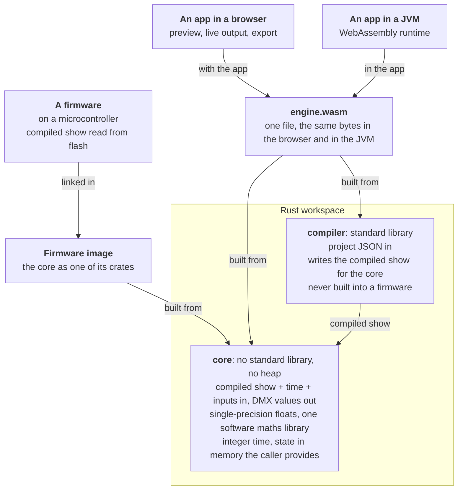

# Lighting engine – concept

One lighting engine, written once in Rust: a core which plays a show on a microcontroller, in a browser and in a JVM
alike, and a compiler which turns a project into the compiled show the core plays.

Status: concept, 11 November 2026. The core, the compiler and `engine.wasm` exist in this repository and pass the
conformance cases (see `README.md`); the measurements on the targets are still to do. Figures marked _estimate_,
_proposed_ or _to measure_ are not measured. How a host uses the engine, and when it switches to it, is decided and
written down where the host is, not here.

## 1. Decisions

| Topic                  | Decision                                                                                                                                    |
| ---------------------- | ------------------------------------------------------------------------------------------------------------------------------------------- |
| Language of the engine | **Rust**, as a core without the standard library and without a heap (section 3)                                                             |
| Builds                 | **Two binaries for three kinds of hosts:** the core as a crate of a firmware, and one `engine.wasm` for a browser and for a JVM (section 4) |
| Numbers                | **Single-precision floats everywhere**, with one software maths library on all targets (section 5)                                          |
| Time                   | **A 64-bit integer, passed in** (section 5)                                                                                                 |
| The show a core plays  | **A versioned compiled format with feature bits** (section 6)                                                                               |
| Projects               | **The compiler reads the current project version only.** A host migrates an older project before it hands it over                           |
| Audio                  | **An input of the hosts which have it.** A host without audio passes none                                                                   |
| Repository             | **This one**, which publishes the `.wasm` file per version                                                                                  |

## 2. What the engine is for

A project describes a show: fixtures with their profiles (in the format of the Open Fixture Library), presets with steps
and effects, scenes, and compositions with a timeline. The engine turns a project and a moment into the value of every
channel of every fixture.

It has three kinds of hosts, and what each of them can afford sets its rules:

|                     | A firmware on a microcontroller                          | An app in a browser                  | An app in a JVM                            |
| ------------------- | -------------------------------------------------------- | ------------------------------------ | ------------------------------------------ |
| Takes the engine as | The core, as a crate (or a static library)               | `engine.wasm`                        | `engine.wasm`, in a WebAssembly runtime    |
| Reads               | A compiled show copied onto it                           | Project JSON, compiled on every edit | Project JSON, compiled when it is loaded   |
| Numbers             | Single precision in hardware, doubles only in software   | Doubles                              | Doubles                                    |
| Memory              | A few hundred KB, no heap to rely on                     | Plenty                               | Plenty                                     |
| A frame             | Every 25 ms, with a full universe taking 22.7 ms to send | On every animation frame             | Every 25 ms, beside audio and video        |
| A fault             | Must not happen: nobody is there to restart it           | A reload                             | Must not take audio and video down with it |
| Updates             | Rarely, by hand                                          | By itself                            | With the app                               |

The engine replaces engines written for one host each, in the language of that host, and kept equal by hand. Two things
of theirs make a shared core easier than a fresh start:

- **The conformance cases.** 30 files of cases, recorded from those engines, say what a project has to look like at each
  moment (`conformance/`). They are the acceptance test of the core.
- **The discipline for equal numbers.** Those engines compute in doubles and avoid every function which rounds
  differently from one platform to the next. The core needs little maths beyond floor, min, max, abs and square root: a
  sine.

## 3. Rust or C

Rust for the core, because the same source has to give the same bits on three targets, and Rust's defaults already do
what C needs flags for. A microcontroller needs native code, not C as such.

| Question                                   | Rust                                                                                                                                                                       | C                                                                                                                                                                                                                                                     |
| ------------------------------------------ | -------------------------------------------------------------------------------------------------------------------------------------------------------------------------- | ----------------------------------------------------------------------------------------------------------------------------------------------------------------------------------------------------------------------------------------------------- |
| A core without the standard library        | `#![no_std]` is a mode of the language: a call into the standard library does not compile                                                                                  | A convention, kept by review and by what is linked                                                                                                                                                                                                    |
| The same maths library everywhere          | Without the standard library there is no `sin` at all, so the `libm` crate (written in Rust) is the only source on every target                                            | Each toolchain brings its own libm (newlib on a chip, another for WebAssembly); a vendored one needs `-fno-builtin` on every build                                                                                                                    |
| Fused multiply-add                         | Never formed from `a * b + c`; only an explicit `mul_add` fuses ([f32 docs](https://doc.rust-lang.org/std/primitive.f32.html))                                             | GCC fuses by default outside the strict ISO modes ([GCC options](https://gcc.gnu.org/onlinedocs/gcc/Optimize-Options.html)). A Cortex-M33 has the instruction and WebAssembly has not, so the bits differ unless every build sets `-ffp-contract=off` |
| Float to DMX value                         | The `as` cast rounds towards zero, saturates, and turns NaN into 0, on every target ([Rust reference](https://doc.rust-lang.org/reference/expressions/operator-expr.html)) | Out of range is undefined behaviour, and differs between targets in practice                                                                                                                                                                          |
| A damaged or hostile show file on a device | Slices are bounds-checked: a bad offset is an error                                                                                                                        | A bad offset is memory corruption unless every read is checked by hand                                                                                                                                                                                |
| WebAssembly                                | `wasm32-unknown-unknown` is a standard target and needs no libc                                                                                                            | Works, through clang or Emscripten, with a libc to choose                                                                                                                                                                                             |
| Microcontrollers                           | `thumbv8m.main-none-eabihf` for a Cortex-M33 and its like                                                                                                                  | The home of every vendor's SDK                                                                                                                                                                                                                        |

What Rust costs:

- **A second toolchain.** The builds of the hosts should not need Rust. This repository's CI publishes the `.wasm` file
  for each version. A firmware in Rust takes the core as a crate; one in C links it as a static library with a generated
  header.
- **A language to learn** for whoever maintains the engine. The core is arithmetic over tables with no threads and no
  heap, which is the easy part of Rust.
- **Panics.** The core builds with `panic = "abort"`, and the lints forbid unchecked indexing and `unwrap` in the frame
  path, so nothing can panic while a show plays.

## 4. Architecture

One Rust workspace holds a core that only computes and a compiler that only translates, and every host reaches them
through the same few calls.

A firmware links the core alone. A browser and a JVM load one WebAssembly file that also holds the compiler, so only
they ever read JSON.

| Call                       | What it does                                                                                                                                                                                              |
| -------------------------- | --------------------------------------------------------------------------------------------------------------------------------------------------------------------------------------------------------- |
| `check(show)`              | Validates a compiled show: version, features, every offset and index, the checksum. Returns the working memory it needs, or the reason it can't be played                                                 |
| `init(show, state)`        | Builds the working state in memory the caller hands over                                                                                                                                                  |
| `set_…(state, time, …)`    | Inputs, each with its time: what plays (a timeline, scenes picked by hand, a preview), the position and the holds of a timeline, tempo, tap and beat one, master dimmer, blackout, identify, audio frames |
| `render(state, time, out)` | Writes the values for that moment, per fixture and as DMX universes after the patch. No allocation, no input or output                                                                                    |
| `compile(json, features)`  | Compiler only: project JSON in, compiled show out, or the list of what the target can't play                                                                                                              |

Rules of the boundary:

- **Only integers, single floats and byte ranges cross it.** No strings, no callbacks, no imports. That is what lets the
  same `.wasm` file run in a browser and in a JVM, and it rules out wasm-bindgen, whose output needs JavaScript glue.
- **Indices, not uuids.** The core knows scene 7, not a uuid. The compiler returns the table from uuid to index for
  hosts that address by uuid.
- **The state is a value, not a global.** A host may run several at once: a preview, a simulation of a device, an
  export.
- **One call at a time per state.** Locks stay in the host.
- **Two outputs.** A 3D preview draws from the values per fixture and a device patches per fixture, so `render` gives
  those as well as the finished universes.

Everything else stays in the hosts: clocks, threads, files, USB, the DMX output, MIDI and the measuring of audio. The
beat clock is in the core, because tap and beat one must behave the same on every host.

## 5. Rules of the core

### No standard library, and no heap either

- No files, threads or clock. JSON lives in the compiler crate.
- No heap in the core. The compiled show states how much working memory it needs, and the caller provides it. A device
  can then refuse a show that is too big before it plays, and the host which copies it can say so before copying.
- No allocation and no unbounded loop in `render`: the work of a frame is fixed by the counts in the show's header.

### Single precision, one maths library, and nothing that changes the bits

- Addition, subtraction, multiplication, division and square root are rounded the same way on a chip, in WebAssembly and
  natively. They need no care beyond using `f32` everywhere.
- The sine comes from the `libm` crate on all targets, after the cycle is reduced to a quarter. The core needs no arc
  tangent and no `pow`: where a spot on the stage points each moving head is worked out by the compiler, in double
  precision, and stored in the show.
- No fused multiply-add, no NaN reaching an output, and float to integer only through the saturating `as` cast.
- Numbers from the project are rounded to `f32` once, in the compiler. A host never does engine arithmetic on them.
- What is fixed is worked out by the compiler in double precision, in a fixed order of operations: the places of the
  fixtures on the stage, in a chase, in a fan and in the picture of a pixel effect.

### Time as a 64-bit integer, reduced before it becomes a float

- The host passes microseconds as a `u64`. A 32-bit count of milliseconds would wrap after 49.7 days, which a show
  looping in a museum can reach. Inside, the core counts nanoseconds in an `i64` (292 years), so a period following the
  tempo is whole to a billionth of a second.
- A float of seconds resolves a millisecond only up to 2.3 hours (2^13 s), and a float of milliseconds counts whole
  milliseconds only up to 4.7 hours (2^24 ms).
- Each effect takes its phase as `(time − start) mod period` in integers and only then converts to a float between 0
  and 1. The precision of a frame never depends on how long the show has run.
- The beat clock keeps its position as a 64-bit fixed-point number of beats and re-anchors on every change.
- The core has no frame rate. A device calls `render` every 25 ms, a preview on every animation frame, and equal times
  give equal values.

### Decisions are made on integers

A tolerance of ±1 covers values, not decisions. Where a comparison picks a step of a chase, a slot of a colour wheel or
the input of a pixel hash, a float that lands on the other side of the line gives a different colour, not a value one
off. Times, step indices and hash inputs therefore stay integers, and a float is never floored into a decision without a
defined rule. This matters most in the pixel patterns and in the steps of a preset.

## 6. The compiled show format

The compiled show is the project with everything fixed already worked out, laid out so a device reads it in place from
flash. Its version rules let a newer compiler keep writing files an older core plays. `docs/format.md` specifies it.

| Part          | Holds                                                                                                                                                |
| ------------- | ---------------------------------------------------------------------------------------------------------------------------------------------------- |
| Header        | Magic number, format major and minor, the feature bits the show requires, the working memory it needs, the number of universes, total length, CRC-32 |
| Chunk table   | Type, offset and length of each chunk. A reader skips optional chunks it doesn't know                                                                |
| Engine chunk  | Fixtures with their channel tables, presets with steps and chase positions, effect curves, pixel maps and palettes, scenes, timelines                |
| Patch chunk   | DMX address and brightness of each fixture, apart from the rest, so a new address at a venue rewrites only this chunk                                |
| Project chunk | Optional: the project JSON, which the core never reads, so that a show copied onto a device can be opened again                                      |

Layout: little-endian, offsets instead of pointers, 4-byte alignment, no strings the engine needs. `check` validates
every offset and index once on load, so a damaged file is refused at the start and not found in the middle of a show.
The format is not a dump of Rust structures through a serialisation library, because it has to outlive the code that
first wrote it.

Version rules:

1. **A feature bit for each new ability.** A new effect, curve or pattern gets a bit. The minor version counts
   additions, and the major version changes only when an old reader could not safely skip what is new.
2. **The compiler sets only the bits a show uses.** A compiler from next year still writes a file that this year's core
   plays, until the show uses something that core lacks.
3. **A core refuses what it can't play, and says why:** an unknown major version, or the feature bits it lacks. A show
   is never played wrongly.
4. **A compiler can be told what the reader can play.** It compiles for the feature bits it is given, or reports which
   of them the show needs and the reader lacks.
5. **Output changes have a version too.** A fix that changes values bumps the core's behaviour version, which a core
   reports. A host can then tell when two cores would play a show differently.

A host which carries the compiler never stores a compiled show. It compiles from JSON with the compiler that sits in the
same file as its core, so reader and writer always match. Only a device meets a file whose writer is newer than its
reader.

## 7. Verification

The core is compared once against the recorded values with a tolerance, and from then on against itself, bit for bit, on
every build.

1. **Against the recorded values, within ±1.** The `channelValues` cases (a project, how it is played, the value of
   every channel at each time) run through compiler and core. The other kinds of case test parts of the engine and are
   tests of the matching Rust modules.
2. **How ±1 is counted.** An 8-bit channel may differ by 1. A channel with a fine channel, such as pan, is compared as
   one 16-bit value, never byte by byte: a difference of 1 can turn a fine byte from 255 to 0. Decisions (step, wheel
   slot, pixel of a pattern) must match exactly. Every difference beyond that is listed and either fixed or explained
   (`conformance/DIFFERENCES.md`).
3. **Then compare exactly.** A digest of the bits of every value of every frame is recorded from the core
   (`conformance/core-digests.json`). Four builds have to come to it:
   - the native build on a developer's machine and in CI;
   - `engine.wasm` in Node;
   - `engine.wasm` in a WebAssembly runtime of the JVM;
   - the Cortex-M33 build, on an emulated M33 in CI and on a real board.
4. **Long runs.** A frame at time _t_ and at _t_ plus a whole number of periods a month later must be equal bit for bit.
   This is the test for integer time.
5. **The format.** Sample files of every released format version stay in the repository, and CI loads them with every
   new core. The loader is fuzzed, because a file on a device is untrusted input.
6. **Speed.** CI times `render` and `compile` on the reference rigs (30 and 60 fixtures, and a rig of pixels) and fails
   on a regression.

The first two of the four builds are compared today. The conformance cases live in this repository, which owns them once
no other engine is left to record them from.

## 8. Plan

| Phase              | What is built                                                                                                                    | Gate                                                                                  | State           |
| ------------------ | -------------------------------------------------------------------------------------------------------------------------------- | ------------------------------------------------------------------------------------- | --------------- |
| 1. Core and format | Format specification, version 1. Compiler and core for dimmers, colours, effect curves, presets with steps, scenes and timelines | The matching `channelValues` cases pass within ±1                                     | Done            |
| 2. Parity          | Pan and tilt, wheels, fans, pixel patterns, audio, scenes picked by hand, holds, identify, the beat clock                        | Every case passes within ±1; the native build and `engine.wasm` come to the same bits | Done            |
| 3. The targets     | The digests in a WebAssembly runtime of the JVM and on an emulated Cortex-M33 in CI; `engine.wasm` built for size                | All four builds exact                                                                 | To do           |
| 4. Releases        | `engine.wasm` published per version for npm and Maven, the core as a crate; samples of each format version kept and loaded in CI | A host can take a version without building the engine                                 | To do           |
| 5. The cases       | The expected values recorded from the core, compared exactly                                                                     | No other engine is left                                                               | After the hosts |

The frame time on a microcontroller and in a JVM, and the compile time in a browser, are measured by the hosts, which
know their hardware and their budgets. From phase 2 on, a new feature of the engine lands here only.

## 9. Risks

| Risk                                                               | What it would change                                              | How it is settled                                                  |
| ------------------------------------------------------------------ | ----------------------------------------------------------------- | ------------------------------------------------------------------ |
| `render` is too slow or needs too much memory on a host            | A limit on fixtures and pixels there, or a native build for a JVM | Measured by the host                                               |
| A recompile takes longer than a frame in a browser                 | The compiler recompiles only what changed                         | Measured by the host                                               |
| Single precision is visibly worse somewhere                        | Fixed-point or a wider intermediate in that one calculation       | The conformance cases; aiming is worked out by the compiler        |
| The format is wrong in a way version 1 can't grow out of           | A second major version before any device ships with it            | Review of the specification before the first release               |
| A new show meets an old core on a device                           | The show is refused until the device is updated                   | Feature bits (section 6)                                           |
| A float floored into a decision differs between doubles and floats | A different colour at an edge                                     | Listed in `conformance/DIFFERENCES.md`; integers where they decide |

## 10. Open questions

- Does the audio input stay in the core, as it is now, or do the effects that follow audio go altogether? And who adds
  up the audio buses an effect names: the host, as today, or the core?
- What a host asks of a project besides frames (when the lights of a composition have gone out, which buses a project
  follows): does the compiler answer it with the index?

Sources: [GCC optimisation options](https://gcc.gnu.org/onlinedocs/gcc/Optimize-Options.html),
[Rust `f32`](https://doc.rust-lang.org/std/primitive.f32.html),
[Rust reference, numeric casts](https://doc.rust-lang.org/reference/expressions/operator-expr.html). All read on 11
November 2026.
